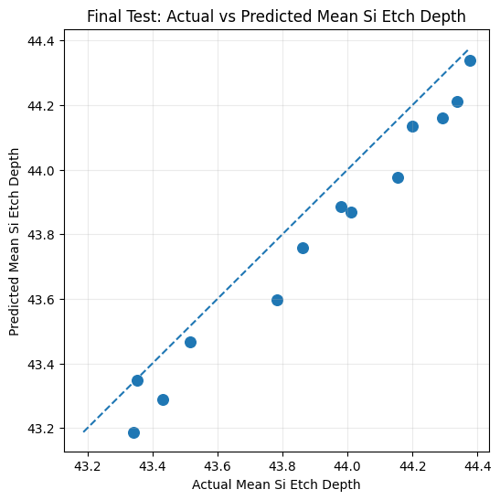

# Plasma Etch Virtual Metrology & Process Drift Analysis

## Overview

This project develops a data-driven **Virtual Metrology (VM) framework for BOSCH plasma etching** using chamber-level process sensor data.

The main objective is to predict post-etch **Si Etch Depth** without relying solely on physical metrology and to investigate how wafer-sequence-dependent process drift is related to etch results.

The project also explores whether global process sensor data can predict **within-wafer uniformity** and the full **89-point spatial etch profile**.

---

## Project Objectives

The project addresses four main questions:

1. Can process sensor data predict the mean Si Etch Depth of an unseen wafer?
2. Which process features are most strongly associated with Etch Depth variation?
3. Does the process state drift as wafers are processed sequentially within a lot?
4. Can chamber-level sensor information explain within-wafer spatial non-uniformity?

---

## Dataset

This project uses the public dataset:

**A Multi-Model Dataset for BOSCH Plasma-Etching: Optical Emission Spectra, Process Parameters, and Wafer Measurements for Data-Driven Plasma Modeling**

DOI: `10.5281/zenodo.17122442`

The dataset was collected from BOSCH plasma etching experiments and contains process parameters, optical emission spectroscopy data, and wafer-level measurements.

This project primarily uses:

- `Process_data.nc`
- `Dictionary_process.nc`
- `Si_Oxide_etch_89_points.csv`
- `Lot_status.xlsx`

The process data contains chamber parameters such as:

- RF Power
- Reflected Power
- DC Bias
- Chamber Pressure
- Foreline Pressure
- Gas Flow
- Backside Helium Pressure / Flow
- Heater Temperature
- Endpoint Intensity

The wafer measurement data contains Si Etch Depth measurements at **89 spatial locations per wafer**.

### Dataset Used in This Project

- Process wafers: 96
- Wafers with 89-point metrology: 88
- Matched supervised wafers: **88**
- Common process signals used: **31**

The raw process data is dictionary-encoded and was decoded using `Dictionary_process.nc`.

Raw dataset files are not redistributed in this repository. Please obtain the data directly from the original Zenodo record.

---

## Analysis Pipeline

```text
Process Sensor Time-Series
        ↓
Dictionary Decoding
        ↓
Main Etch Active Window Detection
        ↓
Wafer-Level Feature Engineering
        ↓
Lot-Aware Train / Validation / Test Split
        ↓
Virtual Metrology Model Comparison
        ↓
Mean Si Etch Depth Prediction
        ↓
Robust Non-uniformity Prediction
        ↓
Unseen-Lot Final Test
        ↓
Ridge Feature Interpretation
        ↓
Wafer-Sequence Process Drift Analysis
        ↓
Process–Etch Relationship Analysis
        ↓
89-Point Spatial Etch Profile Prediction
```

---

## 1. Main Etch Window Detection

Instead of extracting statistics from the entire process recording, the active plasma etch region was automatically detected using `SourceRFLoadPower`.

The active region was defined using a threshold relative to the maximum RF load power.

Across the supervised wafers, the detected active process duration was highly consistent:

- Mean active duration: approximately **597.5 s**
- Standard deviation: approximately **2.1 s**

This allowed process features to be calculated specifically from the main etch region.

---

## 2. Process Feature Engineering

For each of the 31 common process signals, two wafer-level statistics were calculated:

- Mean
- Standard deviation

The active etch duration was also included.

```text
31 Process Signals × 2 Statistics
+ Active Etch Duration
= 63 Candidate Features
```

Features that were constant within the development dataset were removed.

Final input:

**53 Process Features**

The mean features represent the average process operating level, while the standard-deviation features capture process variation and cyclic behavior during BOSCH etching.

---

## 3. Target Definition

The primary target is:

### Mean Si Etch Depth

Calculated from the 89 spatial measurement points of each wafer.

A secondary target was defined as:

### Robust Non-uniformity

To reduce sensitivity to individual abnormal measurement points:

```text
Robust Non-uniformity
= (P95 - P05) / (2 × Mean) × 100
```

This metric was used instead of the conventional max-min formulation for the main uniformity analysis.

---

## 4. Lot-Aware Validation Strategy

A random wafer split was intentionally avoided.

Wafers processed sequentially within the same lot share chamber history and process state. Therefore, randomly separating wafers from the same lot into training and validation datasets could cause information leakage.

The dataset was divided by lot:

### Development Set

Lots 1–8

- **75 wafers**

### Final Test Set

Lots 9–10

- **13 wafers**

Within the development set, **GroupKFold Cross Validation** was performed using lot number as the group.

The final test lots were not used for model selection.

---

## 5. Model Comparison

Three regression approaches were evaluated:

- Ridge Regression
- Random Forest
- XGBoost

A Dummy Mean predictor was used as the baseline.

### Mean Si Etch Depth — Development CV

| Model | MAE | RMSE | Mean R² |
|---|---:|---:|---:|
| Dummy Mean | 0.3321 | 0.3781 | -0.095 |
| Random Forest | 0.1720 | 0.2083 | 0.549 |
| XGBoost | 0.1433 | 0.1796 | 0.637 |
| **Ridge** | **0.1109** | **0.1388** | **0.712** |

Ridge Regression with `alpha = 10` showed the best development cross-validation performance.

---

## 6. Unseen-Lot Final Test

The selected Ridge model was retrained using all 75 development wafers and evaluated once on the 13 unseen wafers from Lots 9–10.

### Mean Si Etch Depth

| Model | MAE | RMSE | R² |
|---|---:|---:|---:|
| Dummy Mean | 0.4006 | 0.4521 | -0.527 |
| **Ridge Regression** | **0.1081** | **0.1205** | **0.892** |

### Final Test: Actual vs Predicted Mean Si Etch Depth



The Ridge model reduced MAE by approximately **73% compared with the Dummy baseline**.

The similarity between the development CV MAE (`0.111`) and final test MAE (`0.108`) also indicates stable generalization to unseen lots.

---

## 7. Uniformity Prediction

Robust Non-uniformity was also modeled using Ridge, Random Forest, and XGBoost.

XGBoost achieved the lowest development CV MAE.

However, on the unseen final test lots:

| Model | MAE |
|---|---:|
| Dummy Mean | **0.1075** |
| XGBoost | 0.1323 |

The model failed to outperform the baseline.

Therefore, the project does **not** claim successful generalization for within-wafer uniformity prediction.

This result suggests that global chamber-level process statistics contain strong information about overall Etch Depth, but may not contain sufficient information to explain wafer-specific spatial variation.

---

## 8. Model Interpretation

Because the final Mean Etch Depth model uses standardized Ridge Regression, the fitted coefficients were analyzed to identify process features associated with Etch Depth prediction.

Important features included:

- Platen RF Tuning Capacitor Mean
- Source RF Reflected Power Variation
- Active Etch Duration
- Source RF Peak-to-Peak Voltage
- Foreline Pressure Variation
- Chamber Pressure Variation
- Source RF Load Power

Both process operating levels and process variation features contributed to prediction.

These coefficients are interpreted as predictive associations rather than causal process mechanisms.

---

## 9. Wafer-Sequence Process Drift

The process features were analyzed as a function of wafer processing sequence within each lot.

Several signals showed consistent sequence-dependent trends across lots.

Examples include:

- Platen RF Tuning Capacitor Mean: increasing
- Source RF Reflected Power Variation: increasing
- Chamber Pressure Variation: increasing
- Source RF Peak-to-Peak Mean: decreasing
- Platen RF Tuning Capacitor Variation: decreasing

The direction of these trends was generally consistent with both:

1. Ridge Regression coefficient directions
2. Observed Mean Si Etch Depth drift

This provides evidence of a statistical relationship:

```text
Wafer Sequence
      ↓
Process State Drift
      ↓
Etch Depth Drift
```

The analysis does not claim that these variables are proven physical root causes.

---

## 10. Process–Etch Relationship

Within-lot Spearman correlation analysis was performed between major process features and Mean Si Etch Depth.

Examples:

| Process Feature | Mean Within-Lot Spearman ρ |
|---|---:|
| Platen RF Tuning Capacitor Mean | -0.854 |
| Source RF Reflected Power Std | -0.820 |
| Platen RF Tuning Capacitor Std | +0.760 |
| Pressure Std | -0.622 |
| Source RF Peak-to-Peak Mean | +0.552 |

For several major features, the empirical within-lot relationship was consistent across most or all lots and matched the sign of the Ridge coefficient.

This strengthened the interpretation that the model was exploiting repeatable process–etch relationships rather than only fitting arbitrary statistical noise.

---

## 11. 89-Point Spatial Etch Profile Prediction

As an extension experiment, the model was expanded from predicting one wafer-level value to predicting all **89 spatial Si Etch Depth measurements simultaneously**.

Input:

```text
53 Process Features
```

Output:

```text
P01, P02, P03, ... , P89
```

A Multi-output Ridge Regression model was used.

### Final Test Result

| Model | Point MAE | Point RMSE | Spatial Correlation |
|---|---:|---:|---:|
| Mean Spatial Profile | 0.4023 | 0.4779 | 0.9997 |
| **Multi-output Ridge** | **0.1419** | **0.2121** | 0.9991 |

The model reduced point-wise prediction MAE by approximately **65%** compared with the mean spatial profile baseline.

However, this improvement required additional investigation.

---

## 12. What Did the Spatial Model Actually Learn?

Each wafer's Mean Etch Depth was removed before evaluating the spatial profile itself.

### Centered Spatial Profile MAE

| Model | MAE |
|---|---:|
| Mean Spatial Profile | 0.1076 |
| Multi-output Ridge | 0.1072 |

The improvement was negligible.

Therefore, the strong 89-point absolute prediction performance mainly resulted from the model correctly estimating the **global Etch Depth level of each wafer**, rather than predicting wafer-specific changes in the spatial pattern.

In simple terms:

```text
Global Etch Depth
→ Predictable

Absolute 89-point Depth
→ Predictable mainly because Global Depth is predictable

Wafer-specific Spatial Variation
→ Limited predictability

Uniformity
→ Did not generalize reliably
```

---

## Key Findings

### Successful

- Automatic detection of the active BOSCH etch region
- Wafer-level process feature engineering
- Lot-aware validation without random wafer leakage
- Strong unseen-lot Mean Si Etch Depth prediction
- Process feature interpretation
- Wafer-sequence process drift analysis
- Process–Etch relationship analysis
- Accurate absolute 89-point Etch Depth prediction

### Limitations

- Robust Non-uniformity did not generalize to unseen lots
- Global process features provided limited information about wafer-specific spatial variation
- High spatial correlation alone was not sufficient to demonstrate spatial prediction capability because the baseline wafer pattern itself was highly consistent

Potential spatial factors such as local temperature distribution, chuck contact, backside helium conditions, radial plasma distribution, or other local process information may need to be incorporated in future work.

These are investigation candidates rather than confirmed root causes.

---

## Main Conclusion

The project demonstrates that chamber-level process sensor data can provide strong predictive information for **global Si Etch Depth** and can capture process drift associated with wafer sequence.

The final Ridge Virtual Metrology model achieved:

```text
Final Unseen-Lot MAE = 0.108
Final Unseen-Lot R²  = 0.892
```

However, the same global sensor features were insufficient to reliably predict **within-wafer spatial uniformity**.

The main conclusion is therefore:

> Chamber-level process sensor data can effectively predict how deeply a wafer is etched, but additional spatial process information is required to reliably predict how uniformly it is etched across the wafer.

---

## Repository Structure

```text
plasma-etch-virtual-metrology/
│
├── README.md
│
├── notebooks/
│   └── plasma_etch_virtual_metrology.ipynb
│
├── figures/
│   ├── model_comparison.png
│   ├── final_test_prediction.png
│   ├── process_drift.png
│   ├── process_etch_relationship.png
│   ├── spatial_actual.png
│   ├── spatial_predicted.png
│   └── spatial_error.png
│
├── results/
│   ├── model_comparison.csv
│   ├── final_test_results.csv
│   └── spatial_test_results.csv
│
├── requirements.txt
└── .gitignore
```

---

## Tools

- Python
- NumPy
- pandas
- Matplotlib
- SciPy
- scikit-learn
- XGBoost
- xarray
- h5py / NetCDF

---

## Notes

This project was developed as a data-science study of semiconductor plasma etching using a publicly available research dataset.

The results represent statistical relationships observed within this dataset and should not be interpreted as validated physical causal mechanisms or direct production-fab process conclusions.
